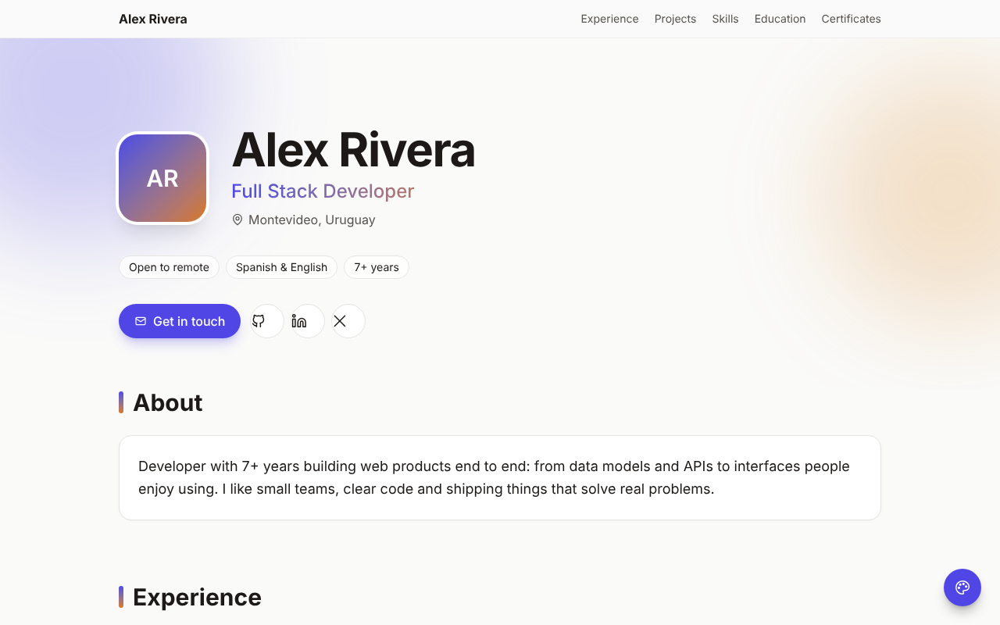
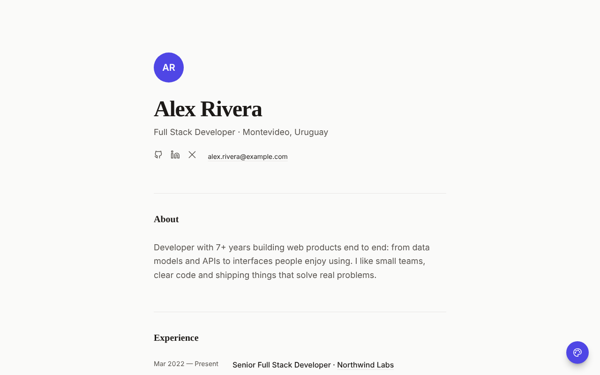
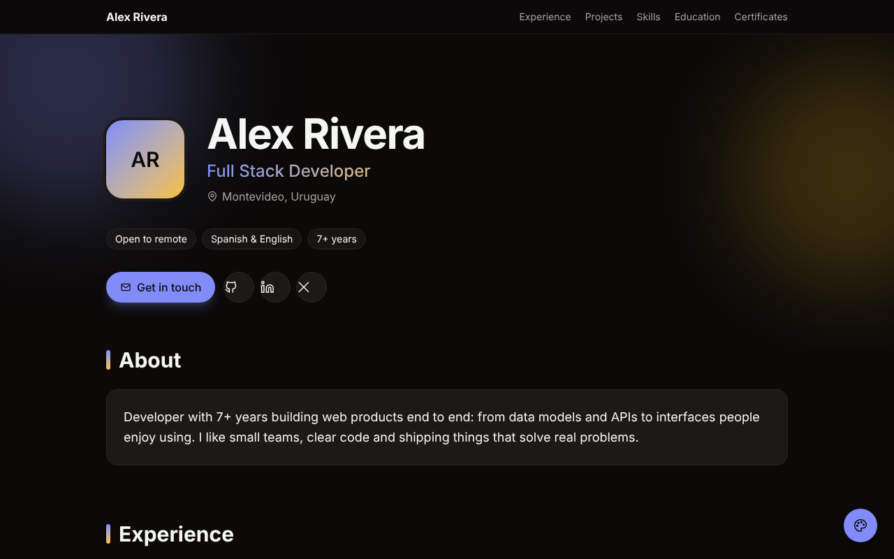
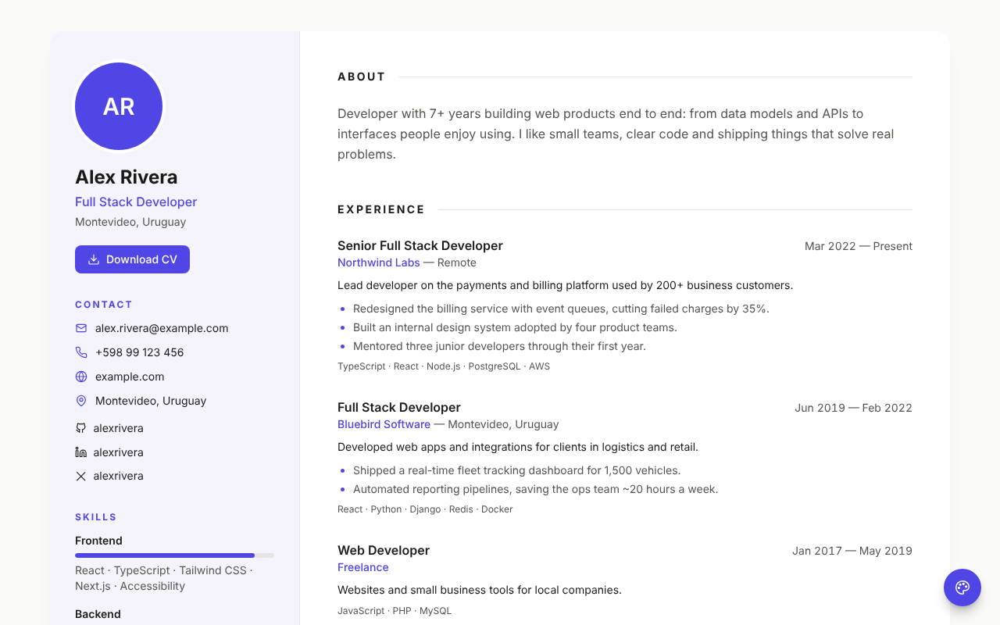
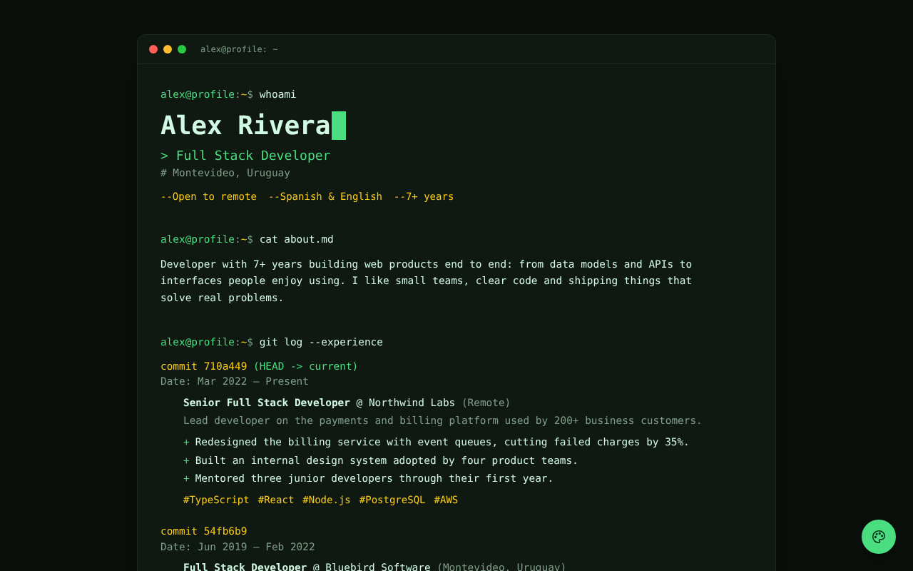
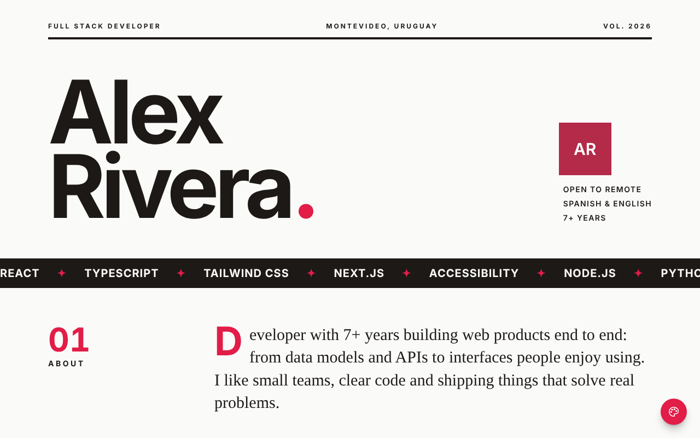

# Professional Profile

Professional profile easy to customize.

A personal CV / portfolio page built with **React**, **Tailwind CSS** and **Vite**.
All your information lives in **one JSON file**, all the look & feel in **one config file**,
and the same data can be shown in **5 different styles**.



## Features

- **One data file** — `src/data/profile.json`, with a JSON Schema for autocompletion in VS Code.
  The format is close to [JSON Resume](https://jsonresume.org), so you can reuse an existing resume.
- **One config file** — `profile.config.ts`: colors (light & dark), style, sections, texts.
- **5 styles, same data** — Minimal, Modern, Classic CV, Terminal and Editorial.
- **Live style switcher** — visitors can try every style and light/dark mode (optional).
- **Simple animations** — scroll reveals, animated skill bars, typewriter, smooth transitions between styles.
  Disabled automatically for users with *reduce motion*.
- **Responsive and printable** — the Classic CV style prints cleanly on A4 / Letter.
- **Reusable components** — `Reveal`, `SkillBar`, `Typewriter`, `SocialLinks`, `ContactList`, `Avatar`, `Tags`, `Icon`.
- **No extra libraries** — just React and Tailwind. Icons are inline SVG.

## Styles

| Minimal | Modern | Classic CV |
| :---: | :---: | :---: |
|  |  |  |

| Terminal | Editorial |
| :---: | :---: |
|  |  |

You can also open any style directly with the URL: `?variant=terminal&mode=dark`.

## Getting started

```bash
git clone https://github.com/smogliazza/profesional-profile.git
cd profesional-profile
npm install
npm run dev
```

Then open http://localhost:5173.

## Customize it

### 1. Your data → `src/data/profile.json`

```json
{
  "basics": {
    "name": "Your Name",
    "label": "What you do",
    "image": "./me.jpg",
    "email": "you@example.com",
    "location": "City, Country",
    "summary": "A couple of lines about you.",
    "profiles": [{ "network": "github", "username": "you", "url": "https://github.com/you" }]
  },
  "work": [],
  "projects": [],
  "skills": [],
  "education": [],
  "languages": [],
  "certificates": [],
  "interests": []
}
```

- Dates are `"2024-03"`, `"2024"` or `"present"`.
- Leave `image` empty to show your initials. Put your photo in `public/` and use `"./me.jpg"`.
- Empty or missing sections are hidden automatically.
- `skills[].level` (0–100) is optional; some styles show it as a bar.

### 2. Look & feel → `profile.config.ts`

```ts
export default defineConfig({
  variant: 'modern',      // 'minimal' | 'modern' | 'sidebar' | 'terminal' | 'editorial'
  showSwitcher: true,     // floating style switcher
  colorMode: 'system',    // 'light' | 'dark' | 'system'
  animations: true,

  sections: ['about', 'experience', 'projects', 'skills', 'education', 'contact'],

  colors: {
    light: { primary: '#0ea5e9', accent: '#f97316' },
    dark: { primary: '#38bdf8' },
  },

  // Tweak a single style
  variants: {
    terminal: { colors: { dark: { primary: '#22d3ee' } } },
  },

  // Translate the page
  labels: { experience: 'Experiencia', projects: 'Proyectos' },
})
```

| Color token | Used for | Tailwind classes |
| --- | --- | --- |
| `page` | Page background | `bg-page` |
| `surface` | Cards, panels, sidebar | `bg-surface` |
| `ink` | Main text | `text-ink` |
| `muted` | Secondary text | `text-muted` |
| `line` | Borders, dividers | `border-line` |
| `primary` | Links, buttons, highlights | `bg-primary`, `text-primary` |
| `onPrimary` | Text on top of primary | `text-on-primary` |
| `accent` | Details and gradients | `text-accent`, `to-accent` |

Any CSS color works (hex, `rgb()`, `hsl()`, `oklch()`), and opacity modifiers too (`bg-primary/10`).

### 3. Add your own style

1. Create `src/variants/MyStyle.tsx` — use `useProfile()` to read the data and the color classes above.
2. Register it in `src/variants/index.ts` and `src/variants/meta.ts`, and add its id to `VariantId` in `src/config/types.ts`.

## Project structure

```
profile.config.ts          ← colors, style, sections, texts
src/
├── data/
│   ├── profile.json       ← your information
│   └── profile.schema.json
├── variants/              ← the 5 page styles
├── components/            ← reusable building blocks
├── theme/ThemeProvider.tsx← applies colors, mode and style
├── config/                ← config types and defaults
└── lib/                   ← helpers (dates, class names, data hook)
```

## Deploy

**GitHub Pages:** the included workflow (`.github/workflows/deploy.yml`) builds and publishes the site on every push to `main`.
Enable it once in *Settings → Pages → Source: GitHub Actions*.

**Anywhere else:** `npm run build` and upload the `dist/` folder (Netlify, Vercel, Cloudflare Pages, any static host).

## License

[MIT](LICENSE) — copy it, change it, make it yours.
